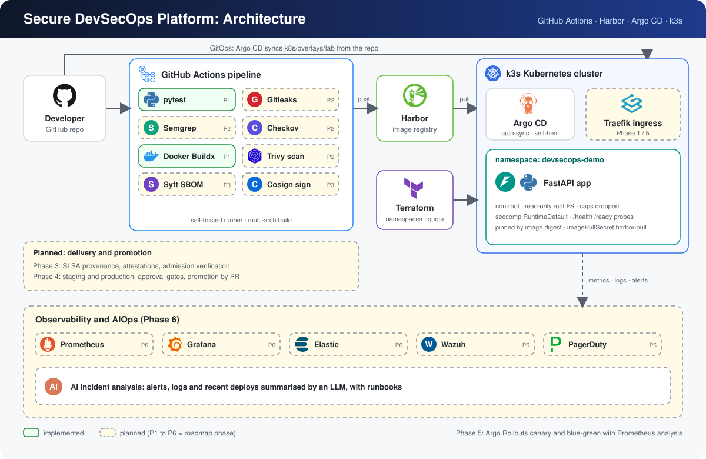

<div align="center">

# 🛡️ Secure DevSecOps Platform

**A hands-on reference platform for secure CI/CD, GitOps delivery and supply-chain security on Kubernetes.**


</div>

---

## 📐 Architecture



Solid boxes are implemented today. Dashed boxes are planned and tagged with the roadmap phase (P1 to P6) that delivers them.

**Flow**
1. A push to `main` starts the GitHub Actions pipeline: tests first, then a multi-arch image build.
2. The image is pushed to Harbor at `harbor.adnovumlabs.com/aidemo/devsecops-demo`.
3. The deployed image is pinned by digest in `k8s/overlays/lab/kustomization.yaml`.
4. Argo CD watches the repo and syncs `k8s/overlays/lab` into the `devsecops-demo` namespace with auto-sync, prune and self-heal.
5. The cluster pulls the image from Harbor using the `harbor-pull` image pull secret.
6. Terraform provisions the `argocd` and `devsecops-demo` namespaces and the resource quota.

## 🧰 Tech stack

| Area | Tools |
|------|-------|
| Application | Python 3.12, FastAPI, Uvicorn, pytest, httpx |
| CI | GitHub Actions (hosted runners for tests, self-hosted runner for builds), Docker Buildx |
| Registry | Harbor |
| GitOps | Argo CD, Kustomize |
| Runtime | k3s (Kubernetes) |
| Infrastructure as code | Terraform |
| Security (planned) | Gitleaks, Semgrep, Hadolint, Checkov, Trivy, Syft, Cosign, SLSA provenance |
| Delivery (planned) | Argo Rollouts, Traefik ingress |
| Observability (planned) | Prometheus, Grafana, Elastic, Wazuh, PagerDuty, LLM incident analysis |

## 📁 Repository layout

```text
.
├── application/             FastAPI app, Dockerfile, requirements, tests
│   ├── app/main.py
│   └── tests/
├── k8s/
│   ├── base/                Deployment and Service
│   ├── overlays/lab/        Lab overlay (image digest pin)
│   └── argocd/              Argo CD Application
├── infrastructure/terraform/  Namespaces and resource quota
├── .github/workflows/       CI pipeline (build.yml)
├── docs/                    Architecture diagram and notes
└── TODO.md                  Phase-by-phase roadmap
```

## 🚀 The application

A small FastAPI service used as the deployment target.

| Endpoint | Purpose |
|----------|---------|
| `GET /` | Application name, version and status message |
| `GET /health` | Liveness probe |
| `GET /ready` | Readiness probe |
| `GET /version` | Application version (`APP_VERSION` env var) |
| `GET /api/orders` | Sample data |

Run it locally:

```bash
cd application
python -m venv .venv && source .venv/bin/activate
pip install -r requirements.txt
uvicorn app.main:app --reload --port 8000
```

Run the tests:

```bash
cd application
PYTHONPATH=. pytest -v
```

## 🔐 Workload hardening

The Deployment in `k8s/base/deployment.yaml` already applies:

- Runs as non-root (UID/GID 10001) with `runAsNonRoot`
- `readOnlyRootFilesystem`, `allowPrivilegeEscalation: false`, all capabilities dropped
- `seccompProfile: RuntimeDefault`
- CPU and memory requests and limits, plus a namespace resource quota
- Liveness and readiness probes
- Image referenced by digest, not a mutable tag

## ☸️ Deploying

**Prerequisites:** a k3s cluster, Argo CD installed in the `argocd` namespace, and access to Harbor.

1. Provision namespaces with Terraform:
   ```bash
   cd infrastructure/terraform
   cp terraform.tfvars.example terraform.tfvars   # set your kube context
   terraform init && terraform apply
   ```
2. Create the Harbor pull secret (use a robot account with pull access to the `aidemo` project):
   ```bash
   kubectl -n devsecops-demo create secret docker-registry harbor-pull \
     --docker-server=harbor.adnovumlabs.com \
     --docker-username='<robot-account>' \
     --docker-password='<token>'
   ```
3. Register the application with Argo CD:
   ```bash
   kubectl apply -f k8s/argocd/application.yaml
   ```
4. Set the CI secrets `HARBOR_USERNAME` and `HARBOR_PASSWORD` in the GitHub repository.

Pin a new image by editing `k8s/overlays/lab/kustomization.yaml`. Use `digest:`, never `newTag`, together with a digest:

```yaml
images:
  - name: devsecops-demo
    newName: harbor.adnovumlabs.com/aidemo/devsecops-demo
    digest: sha256:<digest>
```

See [`docs/registry.md`](docs/registry.md) for registry details.

## 🗺️ Roadmap

| Phase | Focus | Highlights |
|-------|-------|------------|
| 1 | Foundation | CI/CD baseline, digest write-back, workload hardening, docs |
| 2 | DevSecOps security | Gitleaks, Semgrep, Checkov, Trivy, security gates, vulnerability policy |
| 3 | Supply-chain security | Syft SBOM, Cosign keyless signing, SLSA provenance, attestations, verification |
| 4 | GitOps and deployment | Staging and production, approval gates, promotion by PR |
| 5 | Progressive delivery | Argo Rollouts, canary and blue-green, Prometheus analysis, auto rollback |
| 6 | Observability and AIOps | Prometheus, Grafana, Elastic, Wazuh, PagerDuty, AI incident analysis |

The detailed checklist lives in [`TODO.md`](TODO.md).

## 🩺 Troubleshooting

| Symptom | Likely cause and fix |
|---------|----------------------|
| `invalid reference format` on the image | A digest was put in `newName` with `newTag`. Use `newName` plus `digest:`. |
| `no basic auth credentials` / `ImagePullBackOff` | The `harbor-pull` secret is missing or has the wrong registry host. |
| Image host does not resolve | DNS is resolved by the node's container runtime, not by Argo CD. Fix `/etc/hosts` or DNS on the k3s node. |
| Argo CD still shows old manifests | Argo CD renders from GitHub. Push the change, then hard-refresh the app. |
